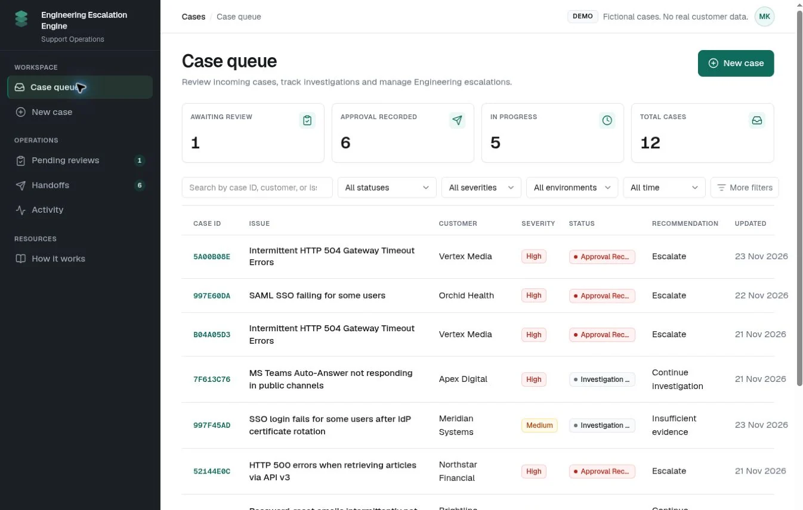
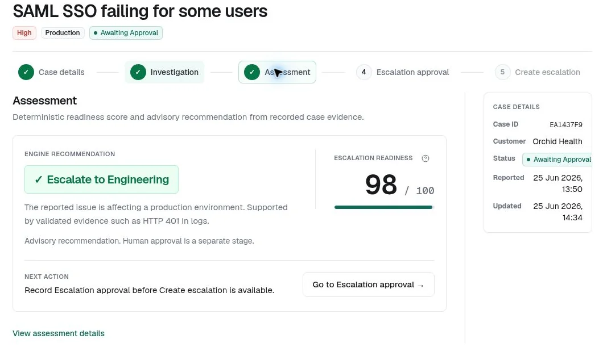
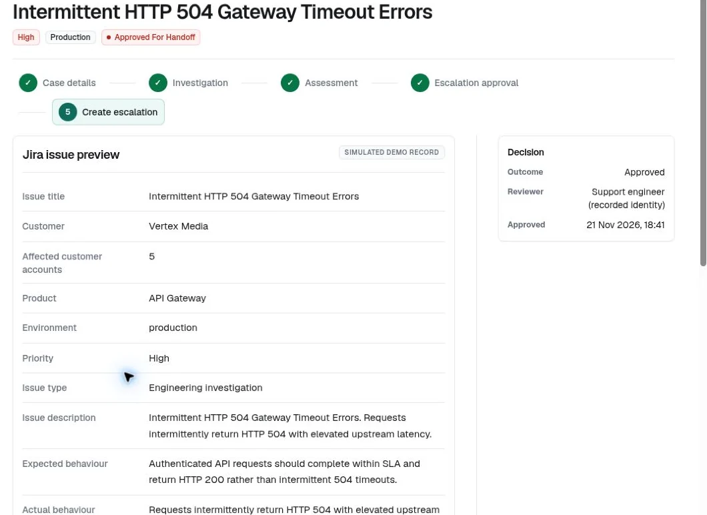

# Engineering Escalation Engine

An interactive Support Operations demo for reviewing technical evidence, assessing escalation readiness and preparing an Engineering handoff after human approval. I built it to show how Support can give Engineering the impact, reproduction steps and evidence it needs to pick up a case.

[Try the live demo](https://engineering-escalation-engine.vercel.app/) · [Read the portfolio case study](https://madihaintech.me/engineering-escalation-engine.html)



## Walk through the demo

Open the **Case Queue** and choose **Orchid Health** to review evidence and record an approval, **Meridian Systems** to see the insufficient-evidence path, or **Vertex Media** to start from an approved handoff.

| Stage | What happens |
| --- | --- |
| **Case details** | Review the reported issue, affected product and environment, and expected and actual behaviour. |
| **Investigation** | Review scope, impact, reproduction, troubleshooting and technical evidence such as logs, request IDs and screenshots. |
| **Assessment** | Inspect the readiness score, contributing factors and advisory recommendation. Cases with insufficient evidence stay in investigation. |
| **Escalation approval** | A reviewer checks the evidence, edits the rationale and decides whether to approve or continue investigating. |
| **Create escalation** | Review the approved handoff, preview a simulated Jira issue or Rootly incident, and save or reopen the record in the app. |

The **Activity** page shows recorded events for cases visible to the visitor. **How it works** explains the five stages in the app.



## Architecture and decision safeguards

- **Application.** Next.js App Router, React and TypeScript. Server Actions and versioned Route Handlers call application services for case management, analysis and decisions. See the [REST API reference](docs/api.md).
- **Advisory analysis.** The server-side OpenAI Responses API returns a structured response validated with Zod. The pipeline checks extracted evidence against the recorded input. Shared examples use predefined analysis data.
- **Deterministic scoring.** TypeScript rules apply fixed weights and thresholds to case signals, including validated evidence. The score and contributing factors explain the recommendation. Identical scoring inputs yield the same result.
- **Human approval.** Approval requires a recorded human decision and rationale. The decision service prepares a handoff from the case, assessment and decision data only when approval succeeds. Downstream creation also checks that approval and a handoff exist.
- **Persistence and verification.** The hosted app uses Supabase Postgres for cases, evidence, assessments, decisions, handoffs, audit events and simulated records. Local development can use an in-memory repository. ESLint and Vitest cover code quality and core workflows.

## Demo boundaries

Visitors can browse fictional examples without signing in. Supported decisions and simulated downstream creation use a signed, anonymous visitor session. The app copies the shared case into that visitor’s workspace for those actions, preserving the shared template. Saved demo records can be reopened within the workspace’s default 48-hour lifetime.

**Jira and Rootly are simulated.** The app generates previews and saves records internally. It makes no requests to Jira or Rootly and creates no records in either external system.

The hosted app is a portfolio demo. Use fictional data only. The visitor cookie scopes the demo workspace. An enterprise deployment would require account authentication and role-based access controls. See [SECURITY.md](SECURITY.md).



## Local development

Use Node.js 22 or later and npm. From a checkout, start the app with the in-memory repository:

```bash
npm ci
cp .env.example .env.local
npm run dev
```

Open [http://localhost:3000](http://localhost:3000). The local case queue starts empty. To load the fictional examples, restart the dev server with seeding enabled, then call the local seed route from another terminal:

```bash
ALLOW_DEMO_SEED=1 npm run dev
curl -X POST http://localhost:3000/api/demo/seed
```

The seed route fills the running app’s in-memory repository using predefined analysis, so it needs no OpenAI key. In-memory data is lost when the server restarts. Set `OPENAI_API_KEY` in `.env.local` only if you want to analyse new fictional cases with OpenAI.

For persistent local development, use a separate non-production Supabase project. Apply the SQL files in [`supabase/migrations`](supabase/migrations) in timestamp order, set `CASE_REPOSITORY=supabase`, and set `SUPABASE_URL` and `SUPABASE_SERVICE_ROLE_KEY` in `.env.local`. Keep the service role and OpenAI keys server-side. See the [database notes](supabase/README.md) for schema and test context.

```bash
npm run lint
npm test
npm run build
```

The standard checks use local fixtures. Live Supabase integration checks are opt-in. The [previous README](https://github.com/KhanKMadiha/engineering-escalation-engine/blob/66619c7967a1924891bb53a2c2fba0be19a9d567/README.md) preserves the original implementation notes.
